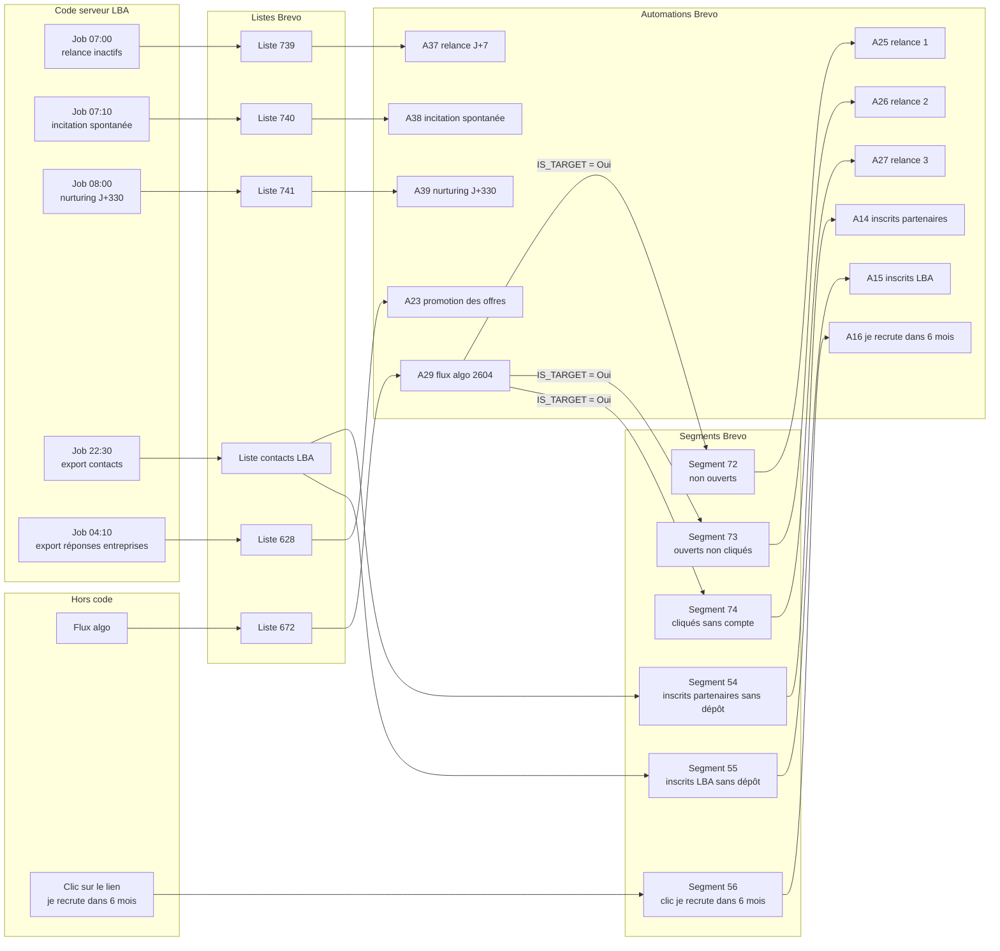
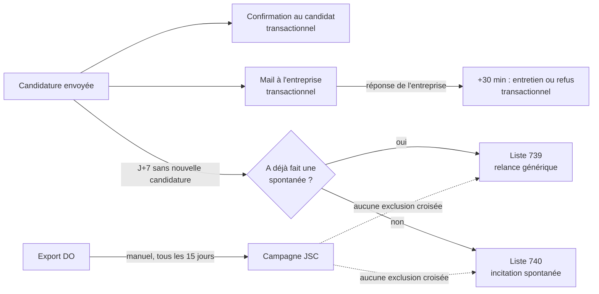
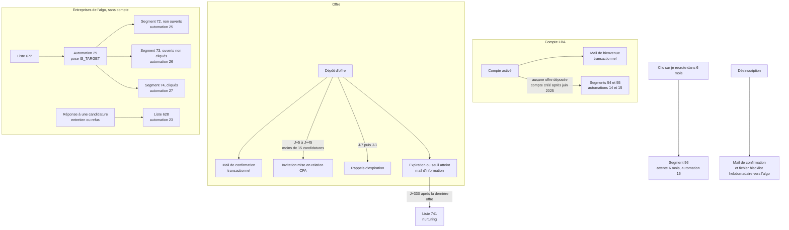

# Cartographie des flows de nurturing (entreprises et jeunes)

Vue d'ensemble de tout ce que La bonne alternance envoie automatiquement aux **jeunes** et aux **entreprises** : ce qui part, à qui, quand, et comment c'est fabriqué (code, liste Brevo, automation, template). Elle complète les docs par dispositif : [relance candidats inactifs](./relance-candidats-inactifs.md), [incitation spontanée](./relance-incitation-spontanee.md), [nurturing des entreprises dormantes](./nurturing-entreprises.md).

Relevé réalisé le **12/10/2026** (issue #5629) : le code a été lu en entier ; côté Brevo, les 11 automations, 6 segments et 2 listes du compte `/ut7 - mailing` ont été consultés en lecture seule. Les flows CFA et OPCO sont hors périmètre (liste en [annexe](#annexe--flows-cfa-et-opco-hors-périmètre)).

## Les trois mécaniques

| Mécanique | Fonctionnement | Qui la pilote |
|---|---|---|
| **1. Mail transactionnel** | Le serveur envoie un mail au moment d'un évènement (candidature, dépôt d'offre, expiration…) via SMTP Brevo, avec un template MJML local ([`server/static/templates/`](../server/static/templates/), envoi par [`mailer.service.ts`](../server/src/services/mailer.service.ts)) | Dev |
| **2. Job + liste Brevo + automation** | Un job cron agrège Mongo et pousse des contacts dans une **liste Brevo** ([`uploadContactListToBrevo`](../server/src/services/brevo.service.ts)). Une automation « ajouté à une liste → 1 mail » envoie le message | Dev (job) et growth (mail, automation) |
| **3. Automation Brevo seule** | Brevo trie lui-même les contacts par **segment** (attributs, ouvertures, clics) et envoie. Rien dans le code | Growth |

Le code ne pilote jamais les campagnes ni les automations : il alimente des listes, les automations et les templates vivent dans l'interface Brevo. Les identifiants de listes sont lus dans [`config.ts`](../server/src/config.ts) (bloc `brevo.listIds`), depuis les secrets SOPS.

## Vue d'ensemble : d'où partent les mails

Les nombres (`739`, `628`, `37`…) sont les **identifiants Brevo** des listes, segments et automations. Les numéros d'automation (`A37`) sont ceux de l'URL `app.brevo.com/automation/edit/<n>`.

## Jeunes

### Inventaire

| Flow | Cible | Déclencheur | Fabrication | Règles | Volume cumulé |
|---|---|---|---|---|---|
| Confirmation de candidature | Le candidat | Candidature envoyée | Transactionnel `mail-candidat-offre-emploi` ([`application.service.ts`](../server/src/services/application.service.ts)) | — | chaque candidature |
| Réponse de l'entreprise | Le candidat | 30 min après l'intention saisie par l'entreprise | Cron `*/10` « Emission des intentions des recruteurs » → `mail-candidat-entretien` / `mail-candidat-refus` | Tracé dans `applicants_email_logs` (`INTENTION_ENTRETIEN` / `INTENTION_REFUS`) | chaque réponse |
| Échec d'envoi | Le candidat | PJ infectée, ou adresse de l'entreprise en hardbounce | `mail-echec-envoi-candidature`, `mail-candidat-hardbounce` | — | évènementiel |
| **Relance candidats inactifs** (liste 739, A37) | Candidats dont la dernière candidature date de 7 jours **et** ayant déjà fait ≥ 1 candidature spontanée | Job 07:00 → liste → automation | [`relance-candidats-inactifs.ts`](../server/src/jobs/applications/relance-candidats-inactifs.ts) | Une fois à vie par candidat (`RELANCE_INACTIVITE`) | 44 000 |
| **Incitation à la spontanée** (liste 740, A38) | Même déclencheur, candidats n'ayant **jamais** fait de spontanée | Job 07:10 → liste → automation | [`relance-incitation-spontanee.ts`](../server/src/jobs/applications/relance-incitation-spontanee.ts) | Une fois à vie (`RELANCE_INCITATION_SPONTANEE`) | 38 800 |
| Campagnes « jeunes sans contrat » | Export DO (~25 800 jeunes) | Manuel, tous les 15 jours en sept.–nov. | Campagnes Brevo manuelles | Aucune exclusion avec les relances | une par export |

Les mails reçus par les entreprises à chaque candidature (`mail-candidature`, `mail-candidature-spontanee`) sont décrits côté entreprises.

### Parcours

## Entreprises

### Flows fabriqués par le code

| Flow | Cible et critères | Déclencheur | Fabrication | Règles |
|---|---|---|---|---|
| Bienvenue | Compte entreprise activé | Validation du rôle | Transactionnel `mail-bienvenue-entreprise-sans-offre` (aucune offre) ou `mail-bienvenue` ([`user-recruteur.service.ts`](../server/src/services/user-recruteur.service.ts)) | — |
| Nouvelle offre | Entreprise qui dépose une offre | Dépôt | `mail-nouvelle-offre`, `mail-nouvelle-offre-depot-simplifie` | — |
| Invitation à la mise en relation CFA | Offres LBA créées il y a 5 à 45 jours, non déléguées, actives, < 15 candidatures, avec un CFA à moins de 100 km | Job 01:55 | [`send-mise-en-relation.ts`](../server/src/jobs/mise-en-relation/send-mise-en-relation.ts) → `mail-mer-invitation` | Une fois par offre (`mer_sent`) |
| Rappels d'expiration | Offres LBA actives | Jobs 09:20 (J-7) et 09:25 (J-1) | [`recruiter-offer-expiration-reminder-job.ts`](../server/src/jobs/recruiters/recruiter-offer-expiration-reminder-job.ts) → `mail-expiration-offres` | Une fois par échéance (`relance_mail_expiration_J7` / `_J1`) |
| Offre expirée / seuil de candidatures | Offres LBA | Jobs `*/30` | `mail-offre-expiree-auto`, `mail-offre-seuil-candidatures` | — |
| **Nurturing J+330** (liste 741, A39) | Comptes ENTREPRISE actifs, dernière offre il y a 330 jours | Job 08:00 → liste → automation | [`nurturing-entreprises.ts`](../server/src/jobs/recruiters/nurturing-entreprises.ts), voir [nurturing-entreprises.md](./nurturing-entreprises.md) | Août reporté au 1ᵉʳ septembre, 1×/an |
| Export des contacts | Tous les comptes CFA et ENTREPRISE actifs | Job 22:30 « Emission des contacts vers Brevo » | [`export-contacts-to-brevo.ts`](../server/src/jobs/partenaire-export/export-contacts-to-brevo.ts) (`LBA_BREVO_CONTACT_LIST_ID`) | Attributs mis à jour à chaque passage |
| Export des réponses des entreprises | Candidatures spontanées depuis le 15/09/2025 avec réponse de l'entreprise | Job 04:10 « Export contact recruteurs vers Brevo » | [`export-recruters-to-brevo.ts`](../server/src/jobs/partenaire-export/export-recruters-to-brevo.ts) (`LBA_BREVO_REPONSES_RECRUTEURS_LIST_ID`) | Nom du job trompeur : il exporte les **réponses**, pas les contacts |
| Désinscription algo | Entreprise algo qui se désinscrit | `/desinscription` | `mail-desinscription-algo` ([`unsubscribe-recruteur-lba.service.ts`](../server/src/services/unsubscribe-recruteur-lba.service.ts)) | SIRET ajouté au fichier de blacklist exporté vers l'algo |

### Automations Brevo

Compte `/ut7 - mailing`, 11 automations, toutes actives le 12/10/2026. Chacune suit le schéma **un déclencheur → (attente) → un seul mail**, sans condition d'exclusion, sauf A23 (branche selon la réponse) et A29 (pose l'attribut `IS_TARGET`).

| A | Nom | Déclencheur | Étapes | Objet du mail | Volume cumulé |
|---|---|---|---|---|---|
| 37 | [#739] Relance candidats inactifs J+7 | Ajouté à la liste 739 | 1 mail | « Multipliez vos chances de décrocher votre alternance » | 44 000 |
| 38 | [#740] Incitation candidature spontanée J+7 | Ajouté à la liste 740 | 1 mail | « Multipliez vos chance de trouver une alternance » (sic) | 38 800 |
| 39 | [#741] Nurturing entreprises J+330 | Ajouté à la liste 741 | 1 mail | « Votre recrutement en alternance simplifié » | 221 |
| 23 | 202510_lba_recruteur_algo_repondant-promotion_offres | Filtre : membre de la liste 628 (« Automation_entreprises_algo_dépôt d'offres »), entrée à 9h15 | Branche sur `REPONSE_EMPLOYEUR` : « entretien » → un mail, sinon un autre | « De la candidature spontanée aux candidatures ciblées » / « Trouvez le profil qui vous correspond » | 40 600 |
| 14 | 202506-inscrits_partenaires_sans_dêpot_offres | Segment 54 | Attendre 3 jours → 1 mail | « Vous êtes à la recherche d'un alternant ? » | 1 710 |
| 15 | 202506-inscrits_lba_sans_dêpot_offres | Segment 55 | Attendre 3 jours → 1 mail | « Vous êtes à la recherche d'un alternant ? » | 827 |
| 16 | 202506-relance-je-recrute-dans-6-mois | Segment 56 | Attendre 6 mois → 1 mail | « Prêt à recruter en alternance ? » | 4 990 |
| 29 | 2604_lba_entreprises-algo-automation | Filtre : membre de la liste 672 (« PRODUCTION contacts entreprises »), entrée à 9h45 | `IS_TARGET` = Oui → 1 mail | « Des milliers d'entreprises ont déjà recruté en alternance » | 274 800 |
| 25 | 2602_lba_entreprises_non-ouvert#1 | Segment 72 | Attendre 7 jours → 1 mail | « Des candidats en alternance recherchent une entreprise comme la vôtre » | 627 800 |
| 26 | 2602_lba_entreprises-ouverts-non-cliqués#2 | Segment 73 | Attendre 3 jours → 1 mail | « 2 minutes pour déposer votre offre d'alternance » | 281 700 |
| 27 | 2602_lba_entreprises-cliqueurs-non-dépôt#3 | Segment 74 | 1 mail → attendre 3 jours | « Un accompagnement pour publier votre offre ? » | 28 500 |

Les nombres **739, 740, 741** sont des identifiants de listes Brevo (déclencheur « ajouté à une liste »), pas des numéros de PR.

### Segments

| Segment | Critères | Taille | Alimente |
|---|---|---|---|
| **54** inscrits_partenaires_sans_dêpot_d'offres | Membre de la liste contacts LBA **et** `ROLE_AUTHORIZED_TYPE` = ENTREPRISE **et** `JOB_COUNT` = 0 **et** `USER_ORIGIN` ≠ `lba` **et** `ROLE_CREATEDAT` après le 24/06/2025 | 1 701 | A14 |
| **55** inscrits_lba_sans_dêpot_d'offres | Mêmes critères avec `USER_ORIGIN` = `lba` et `ROLE_CREATEDAT` après le 25/06/2025 | 157 | A15 |
| **56** link-clicked-je-recrute-dans-6-mois | Lien cliqué ≥ 1 fois dans les 6 derniers mois, URL exacte d'une page Notion de mission-apprentissage | 112 | A16 |
| **72** 2602-entreprises-relance-non-ouverts#1 | `IS_TARGET` = Vrai **et** email non ouvert (tout type, 3 mois, ouvertures Apple MPP exclues) **et** `ROLE_CREATEDAT` non rempli | ~499 000 | A25 |
| **73** 2602-entreprises-relance-ouverts-non-clic#2 | Email ouvert ≥ 1 fois (3 mois, MPP exclues) **et** lien non cliqué (3 mois) **et** `IS_TARGET` = Vrai | ~163 000 | A26 |
| **74** 2602-entreprises-clics-non-dépôt#3 | `IS_TARGET` = Vrai **et** lien cliqué ≥ 1 fois (3 mois) **et** `ROLE_CREATEDAT` non rempli | ~8 400 | A27 |

Les segments sont **dynamiques** : ils se recalculent en continu et un contact passe de l'un à l'autre au fil de ses ouvertures et clics. Les critères d'engagement portent sur **tout type d'email** du compte.

### Parcours

## Vérification croisée code ↔ Brevo

| Liste alimentée par le code | Variable | Automation rattachée |
|---|---|---|
| Relance candidats inactifs | `LBA_BREVO_RELANCE_CANDIDATS_LIST_ID` | A37 (liste 739) |
| Incitation spontanée | `LBA_BREVO_RELANCE_SPONTANEE_LIST_ID` | A38 (liste 740) |
| Nurturing entreprises | `LBA_BREVO_NURTURING_ENTREPRISES_LIST_ID` | A39 (liste 741) |
| Réponses des entreprises | `LBA_BREVO_REPONSES_RECRUTEURS_LIST_ID` | A23 (liste 628) |
| Contacts CFA et entreprises | `LBA_BREVO_CONTACT_LIST_ID` | A14 et A15, via les segments 54 et 55 |

- Les automations **sans source dans le code** : A16, A25, A26, A27 et A29 (liste 672, alimentée hors code par l'algo).
- `LBA_BREVO_MARKETING_CONTACT_LIST_ID` est déclarée dans les secrets de production mais n'est lue par aucun code.
- Le code n'utilise qu'**une seule clé API** (`LBA_BREVO_API_KEY`), y compris pour la suppression des contacts de plus de 2 ans.
- Une automation Brevo ne lit pas la blacklist LBA (`emailblacklists`) : elle s'appuie sur le blocage natif de Brevo, que le job de 00:05 recopie ensuite côté LBA.

## Chevauchements et règles d'exclusion

### Règles qui existent

| Règle | Où | Effet |
|---|---|---|
| Relances jeunes disjointes | Code (présence d'une spontanée) | Un candidat n'est jamais dans les deux le même jour |
| Anti-doublon par relance | `applicants_email_logs` | Une fois à vie par flow et par candidat |
| Cap annuel du nurturing | `relance_mail_nurturing`, fenêtre de 330 jours | 1 relance par entreprise et par cycle |
| Entreprise encore active | `nurturing-entreprises.ts` | Pas de relance si offre plus récente ou active |
| Blacklist algo | `blacklist-algo.json` (vendredi 10:00, [`export-blacklist-algo.ts`](../server/src/jobs/partenaire-export/export-blacklist-algo.ts)) : désinscrits et entreprises fermées | Exclusion des SIRET côté algo |
| Sans compte | `ROLE_CREATEDAT` non rempli (segments 72 et 74) | Exclut les entreprises ayant un compte |
| Suppression à 2 ans | Job du dimanche 08:00 | Contacts Brevo non modifiés depuis 2 ans supprimés |

### Chevauchements non couverts

1. **Candidat** : transactionnel + relance J+7 + campagnes JSC, sans exclusion croisée.
2. **Deux relances à vie** : un candidat relancé par A38 peut, après une spontanée puis une nouvelle inactivité, l'être par A37 (chaque flow a son propre log).
3. **Entreprise avec compte et présente dans l'algo** : même SIRET, deux adresses, aucune exclusion par SIRET entre le nurturing J+330 et les flows 2602, 2604 et A23.
4. **Désinscription d'une entreprise algo** : l'exclusion passe par un fichier hebdomadaire exporté le vendredi. Un délai est possible avant l'arrêt effectif des envois (non confirmé).
5. **Segment 73** : il n'exclut pas les entreprises ayant déjà un compte, contrairement aux segments 72 et 74. Une entreprise du flux algo qui a créé son compte reçoit « 2 minutes pour déposer votre offre d'alternance » si elle a ouvert un mail sans cliquer.
6. **« Tout type d'email »** : l'engagement qui classe un contact dans les segments 72, 73 ou 74 compte tous les mails du compte. Une campagne manuelle peut donc déclencher ou déplacer un contact dans une séquence 2602.
7. **A29** n'a aucun garde-fou « a déjà déposé une offre » : le seul tri est l'entrée dans la liste 672.
8. **Segments 54 et 55** : ils ne regardent que les comptes créés après fin juin 2025. Les inscrits plus anciens n'ont jamais été relancés par A14 et A15. `JOB_COUNT` vient de l'export de 22:30 : une entreprise qui dépose une offre sort du segment au plus tôt le lendemain.

Aucun **plafond de fréquence global** n'existe, ni dans le code ni dans Brevo.

## Trous de couverture

**Jeunes**
- Aucune relance après J+7 (une seule relance par design).
- Aucune relance sur les candidats sans réponse de l'entreprise : le type `RELANCE` existe dans `EMAIL_LOG_TYPE` mais n'est utilisé nulle part dans le code applicatif.
- Aucune suite après un refus ou un entretien, au-delà du mail transactionnel.
- Les jeunes qui visitent sans candidater ne sont jamais connus par e-mail.

**Entreprises**
- Entre l'expiration d'une offre et J+330 : un seul mail transactionnel.
- Aucune relance des entreprises qui reçoivent des candidatures sans y répondre, hors rappel d'expiration.
- Les entreprises désinscrites avec le motif « déjà trouvé nos alternants » ne sont pas relancées (#5628, en projet).
- Les entreprises dont les offres viennent de partenaires sont exclues du nurturing J+330 par construction (`partner_label` = LBA uniquement).

## Fragilités connues

- **Fenêtre d'un seul jour** pour les relances jeunes (`last_connection` ∈ [J-8, J-7)) : si le cron saute une journée, ces candidats ne sont jamais relancés, sans rattrapage (contrairement au nurturing J+330 pour août).
- **Trace avant envoi** : si l'import Brevo échoue, les candidats sont déjà marqués comme relancés et ne le seront pas. Choix assumé (« mieux vaut rater que doubler »), signalé par Slack.

## Comment retrouver l'information

| Besoin | Où regarder |
|---|---|
| Tous les jobs planifiés et leur cron | [`server/src/jobs/jobs.ts`](../server/src/jobs/jobs.ts) |
| Identifiants de listes Brevo | [`server/src/config.ts`](../server/src/config.ts), bloc `brevo.listIds` |
| Mails transactionnels | [`server/static/templates/`](../server/static/templates/) et les appels à `mailer.sendEmail` |
| Anti-doublons côté candidat | collection `applicants_email_logs`, enum `EMAIL_LOG_TYPE` ([modèle](../shared/src/models/applicant-email-log.model.ts)) |
| Automations Brevo | `app.brevo.com/automation/edit/<n>` |
| Segments Brevo | `app.brevo.com/contact/segment/id/<n>` |
| Listes Brevo | `app.brevo.com/contact/list/id/<n>` |

**Limites du relevé** : les corps des mails n'ont pas été lus (seuls les objets le sont), et une partie des automations d'un autre espace Brevo (webinaires, campagnes DECA, une automation de 237 000 contacts) n'a pas été consultée. Ce document est à mettre à jour à chaque nouveau flow.

## Annexe : flows CFA et OPCO (hors périmètre)

| Flow | Cron | Template |
|---|---|---|
| Invitation à l'opt-out RDVA | 09:00 | `mail-cfa-optout-invitation` |
| Activation de l'opt-out | 00:50 | `mail-cfa-optout-start`, `mail-cfa-optout-activated` |
| Invitation premium Parcoursup / Affelnet | 09:00 / 09:15, période bornée par la config | `mail-cfa-premium-invite` |
| Relances premium Parcoursup / Affelnet | 09:30 / 09:45 | `mail-cfa-premium-invite-followup` |
| Rappel premium activé (Parcoursup / Affelnet) | 8 janvier / 23 mars | `mail-cfa-premium-activated-reminder` |
| Rappel de validation aux OPCO | Lun., mer., ven. 00:30 | `mail-relance-opco` |
